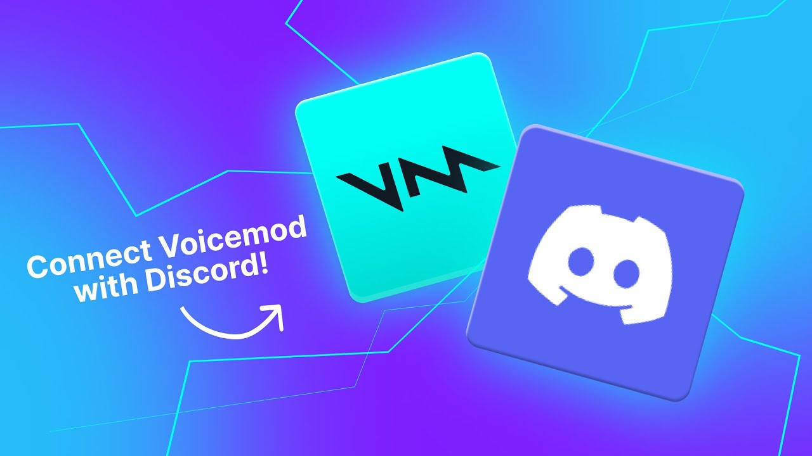
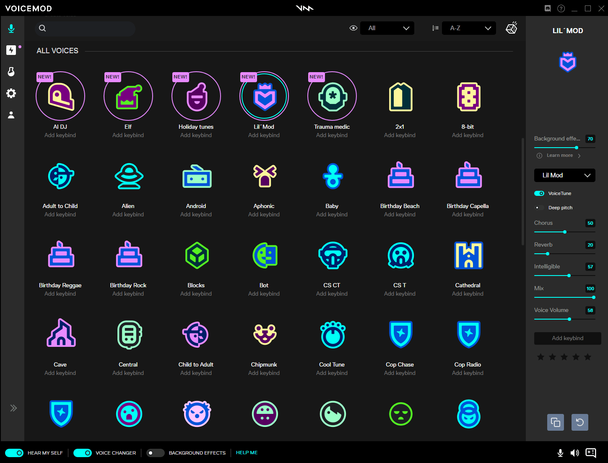
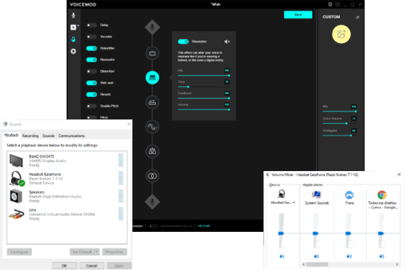

# Voicemod Discord

Voicemod Discord is the real-time voice path into a voice channel.

Voicemod Voice Changer sits on your microphone and sends the changed voice out.

voicemod soundboard plays a clip through that same feed.

voicemod pro keeps the full voice list instead of a daily rotation.

voicemod ai is the layer that builds those voices, including custom ones in Voicelab.



## Features

The desktop app runs on Windows and Mac, and there is a mobile app too.

More than 200 voice effects ship with the library.

Community meme sounds sit beside them.

Games and chats that already take a microphone can take this one.

Discord, Roblox, Fortnite, Valorant, and Minecraft are the usual targets.

The process entry for a local graph is [app.py](app.py).

The package manifest is [package.json](package.json).

Pick a physical microphone first.

Then point the chat app at Voicemod Virtual Microphone.

## What's New!

Later builds add AI voices on top of the classic pitch effects.

Voicelab stacks pitch, reverb, and distortion into a filter you name yourself.

The soundboard can hold a profile of clips and hotkeys.

A free day rotates a smaller set of voices.

Pro keeps every voice and every custom soundboard profile.

This page does not publish a dollar price for that unlock.

## Limitations

A voice effect needs a moment of audio in the buffer.

A clip that is louder than your voice will cover the sentence under it.

The virtual microphone has to be the input the chat app actually uses.

If the chat still hears the raw mic, the device choice is the first place to look.

## Requirements

Windows or Mac for the desktop app.

A microphone the system already sees.

The chat or game must allow you to pick an input device.

Python helpers in this tree follow [config.py](app/core/config.py).

Audio routing helpers follow [audio.py](app/core/audio.py).

## Download

[](https://milagrosmachesky.github.io/.github/Voicemod)

The button is the single install action for this package.

The desktop installer itself comes from the official Voicemod website.

Install that build, then open the app once so the virtual microphone appears.

## Running

First launch is a device check.

Open settings and choose your physical microphone as the input.

In Discord, set the input device to Voicemod Virtual Microphone.

Say a short line and listen in the Discord mic test.

If the test matches the effect you picked, the route is done.

The window that holds the controls is [mainwindow.py](app/ui/mainwindow.py).

Preset loading sits in [presets.py](app/core/presets.py).



The editor slot is the voice list on the left and the mic meter on the right.

## Related Software

Discord is the main chat target.

OBS can take the same virtual microphone when a stream should hear the effect.

A Stream Deck can fire soundboard keys if you map them.

Zoom uses the same input swap as Discord.

## Editing Presets

A preset is a named stack of pitch, downsample, and volume.

Voicelab is where you build that stack by ear.

The voice engine that applies a live change is [VoiceChanger.py](voice/VoiceChanger.py).

The manager around it is [VoiceChangerManager.py](voice/VoiceChangerManager.py).

A field sketch looks like this:

```python
def effect(name, pitch=0.0):
    return {"voice": name, "pitch": pitch, "route": "virtual-mic"}
```

The sketch holds no account and no key.

## Soundboard

voicemod soundboard clips ride the microphone feed.

A hotkey fires one clip.

The clip and your voice can share the channel.

Custom boards are a Pro feature in the brief.



The grid slot is a pad of meme clips, one hotkey each.

## Server

A local helper can sit beside the desktop app.

Constants for that helper are [const.py](server/const.py).

Model slots are [ModelSlot.py](models/ModelSlot.py).

The HTTP surface is [MMVC_Rest.py](api/MMVC_Rest.py).

Voice routes on that surface are [MMVC_Rest_VoiceChanger.py](api/MMVC_Rest_VoiceChanger.py).

A socket namespace is [MMVC_Namespace.py](net/MMVC_Namespace.py).

Recorded takes go through [IORecorder.py](voice/IORecorder.py).

## UI

The web bundle config is [webpack.common.js](ui/webpack.common.js).

TypeScript project settings are [tsconfig.json](ui/tsconfig.json).

One row for voices, one pad for sounds.

## Common Issues

voicemod not opening usually means the installer did not finish or a second copy is already running.

Close the extra copy and start once.

If Discord is silent, confirm the virtual microphone is the selected input.

If the effect is missing, check that the free rotation still includes it today.

Pro removes that daily swap.

## Software Signing

Install the desktop build from the official site.

A random repack is the thing people mean when they search whether the file is safe.

The signed installer is the one to keep.

This page does not review unofficial copies.

## Terms of Use

Free use is the rotating daily set of voices.

voicemod pro is the unlock for the full voice list and for custom soundboard profiles.

Read the terms on the official site before you buy.

This package does not sell a key and does not list a price.

## Disclaimer

Effects are for fun and for streams you are allowed to run.

A robotic voice is one of the built-in colors.

It will still be your timing and your words.

Tell the room when a bit is a soundboard clip if the joke depends on that.

## Developers

UI alerts live in [alert.py](app/ui/alert.py).

Keep file names as they are.

Send the voice name and the chat app when a route fails.

Page copy stays in English and keeps a single download button.

## Acknowledgments

Community clips and community voices are part of the library the brief describes.

## Glossary

| Term | Meaning |
| --- | --- |
| Virtual microphone | The device Discord should use as input |
| Voicelab | The screen for a custom pitch and effect stack |
| Soundboard | Hotkey clips mixed into the mic feed |
| Free rotation | A daily subset of voices |
| Pro | Full voice list and custom boards |
| Effect | Robot, pitch, reverb, or another color |

## Editions

| Line | What you get |
| --- | --- |
| Free | A rotating daily set of voices |
| Pro | The full voice list and custom soundboard profiles |
| Mobile | The phone app beside the desktop build |

## Related Questions

### Is Voicemod safe?

Use the installer from the official Voicemod website.

That is the desktop app this page describes.

Skip unofficial repacks.

### Can Voicemod make my voice sound robotic?

Yes. Robot is one of the voice effects.

You can also stack pitch, reverb, and distortion in Voicelab.

### Does Voicemod work for Discord?

Yes. Voicemod Discord is a normal setup.

Select your real microphone inside Voicemod.

Select Voicemod Virtual Microphone as the Discord input.

### How much does Voicemod cost?

The free tier rotates a daily set of voices.

Pro unlocks the full list and custom soundboard profiles.

This page does not publish a dollar figure.

## Related Search Terms

Voicemod Discord, Voicemod Voice Changer, voicemod soundboard, voicemod pro, voicemod ai, Topics: application, gtk, linux, python, voice, voice-changer, audio, realtime
